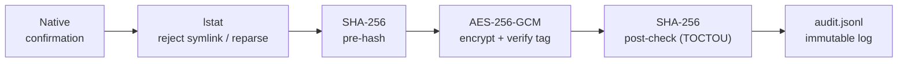
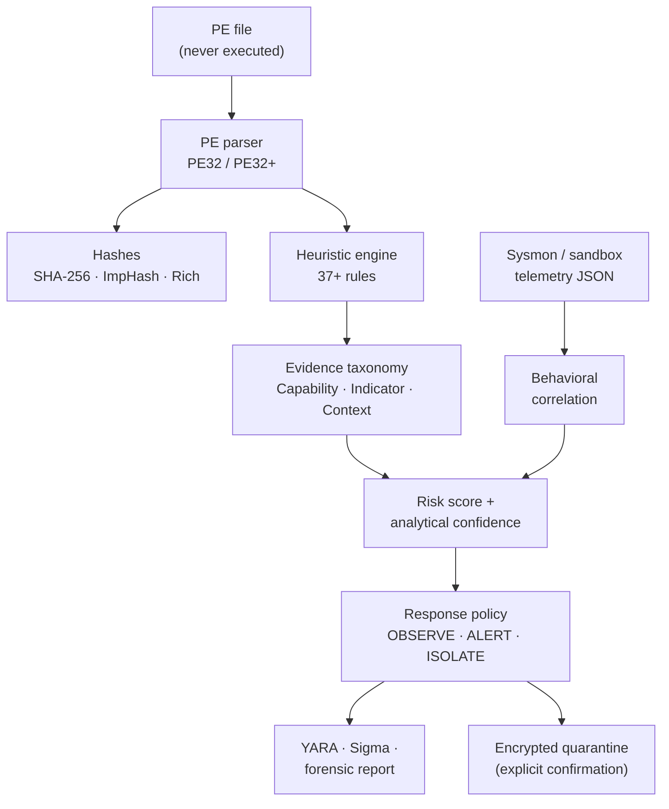

<div align="center">


<br/>

[](LICENSE)
[](https://github.com/whispering3/Sentinel-PE/releases)
[](https://www.electronjs.org/)
[](https://www.typescriptlang.org/)
[](#)
[](#privacy-model)

<br/>

[**Overview**](#overview) &nbsp;·&nbsp; [**Features**](#features) &nbsp;·&nbsp; [**How it works**](#how-it-works) &nbsp;·&nbsp; [**Quick Start**](#quick-start) &nbsp;·&nbsp; [**Scope**](#scope-and-limitations) &nbsp;·&nbsp; [**Contributing**](#contributing)

</div>

<br/>

## Overview

**Sentinel PE** is a free, open source desktop workbench for **explainable threat detection** and **static reverse engineering** of Windows Portable Executable (PE) files. It helps analysts, incident responders and advanced users inspect, classify and isolate **ransomware**, **infostealers** (cookie and credential theft) and **packed binaries**, all **without executing them**.

Every verdict comes with its reasoning: a risk score, an analytical confidence value, and the exact evidence behind both, so you can decide whether to trust it.

<table>
<tr>
<td width="33%" valign="top">

**Static analysis**
Full PE32 / PE32+ dissection, imports, sections, entropy, manifests, .NET metadata, hashes and 37+ heuristic rules.

</td>
<td width="33%" valign="top">

**Reactive protection**
Opt-in folder watching, canary honeypots, suspicious process inspection and an AES-256-GCM encrypted quarantine vault.

</td>
<td width="33%" valign="top">

**Investigation output**
YARA and Sigma generation, a built-in Rule Test Lab and chain-of-custody reports in JSON, Markdown or PDF.

</td>
</tr>
</table>

### Privacy model

> [!IMPORTANT]
> **Files never leave your machine.** The renderer runs with `connect-src 'none'`. The only external interaction is optional: when you explicitly click a lookup link, a **SHA-256 hash** (never the file) is opened on VirusTotal or MalwareBazaar.

<br/>

## Features

### 1. Detection engine

Sentinel PE pairs a **Risk Score (0–100)** with an **Analytical Confidence (0–100%)** and maps them to one of three defensive postures, each with a written rationale:

| Posture | Meaning |
|---|---|
| `OBSERVE` | Weak or ambiguous signals; keep watching |
| `ALERT` | Meaningful evidence; analyst review recommended |
| `ISOLATE / QUARANTINE RECOMMENDED` | Strong, specific evidence of malicious behavior |

To avoid flagging legitimate installers and admin tools, evidence is split into three classes instead of being counted as one pile of API imports:

| Class | What it captures | Examples |
|---|---|---|
| **Capability** | Generic API imports that *could* be abused | `CryptUnprotectData`, `CreateRemoteThread` |
| **Indicator** | High-specificity threat strings and combinations | `vssadmin delete shadows`, `Login Data` + `Network\Cookies` |
| **Context** | Structural properties of the binary | Unsigned, missing ASLR/DEP |

**37+ static heuristic rules** cover four families:

| Family | Coverage |
|---|---|
| **Ransomware** | Shadow copy deletion (`vssadmin`, `wmic`, `wbadmin`), boot recovery sabotage (`bcdedit`, `reagentc`), crypto API + file enumeration combos, `.onion` C2 addresses, extortion notes |
| **Infostealers** | Browser cookie and password stores (`Network\Cookies`, `Login Data`, `Local State`, `cookies.sqlite`, `logins.json`, `key4.db`), DPAPI, Discord / Telegram / Steam session paths, crypto wallets (MetaMask, Phantom, Exodus, Electrum), LSASS / SAM dumping, keylogger and clipper hooks |
| **Injection & packers** | Remote thread injection, process hollowing (`NtUnmapViewOfSection`), APC injection, high-entropy sections (> 7.5 bits/byte), virtual vs. raw size anomalies, UPX / Themida / VMProtect signatures |
| **Persistence & evasion** | Run keys, services, scheduled tasks, token manipulation, UAC bypasses (`fodhelper`, `cmstp`), `requireAdministrator` manifests, debugger detection, VM / sandbox fingerprinting |

### 2. Reactive protection and encrypted quarantine

All of this is **opt-in**, and nothing is deleted silently.

- **Folder watching:** monitors `Downloads`, `Desktop` and `Temp` (`fs.watch`) for new or modified `.exe`, `.dll`, `.scr`, `.com`, `.bat`, `.ps1` and `.vbs` files and raises analytical alerts.
- **Canary honeypots:** deploys decoy files and raises a **Critical Ransomware Alert** on any unauthorized modification, encryption or deletion.
- **Live process inspector:** flags processes running from user-writable folders (`Temp`, `Downloads`, `Public`) or using malicious command lines (`vssadmin`, `bcdedit`, encoded PowerShell, `lsass` dumping). Process identity (`PID` + `Name` + `CreationDate`) is re-verified before any explicit-confirmation **Kill** or **Kill + Quarantine**.
- **Encrypted quarantine vault:** suspicious files are isolated into `*.quarantine` archives only after explicit native confirmation.



### 3. Behavioral correlation

Import Sysmon or sandbox JSON telemetry (Event IDs `1, 3, 8, 10, 11, 12–14, 22`) and Sentinel PE correlates events by process identity (`PID` + `process`) to detect multi-stage chains:

| Chain | Signals correlated |
|---|---|
| **Infostealer** | Execution from a writable path, browser cookie / credential store access, outbound network connection |
| **Ransomware** | Shadow copy sabotage followed by mass file modification |
| **Injection & credential access** | Cross-process thread creation (`Event ID 8`) and `lsass.exe` memory access (`Event ID 10`) |

### 4. Static PE analyzer and Rule Test Lab

- PE32 / PE32+ dissection (MZ, COFF, Optional Header, Data Directories, Subsystem) with strict bounds checking against malformed files
- .NET managed assemblies (CLR header), delay-loaded imports, API Set redirections (`api-ms-win-*`) and embedded XML manifests (`requestedExecutionLevel`)
- Authenticode table presence, clearly separated from cryptographic chain verification
- Hashes: **SHA-256**, **SHA-1**, **MD5**, **ImpHash** and **Rich Header MD5**, plus an instant hash comparator
- **YARA** (hash-pinned and static-indicator) and **Sigma** rule generation with deterministic RFC 4122 v4 UUIDs, validated automatically in the built-in **Rule Test Lab**
- **Chain-of-custody reports** exported as JSON, Markdown or Print / PDF

<!--
  Add screenshots here once you have them, for example:
  <p align="center"></p>
-->

<br/>

## How it works



**Hardened by default.** All privileged operations (`quarantine`, `restore`, `delete`, `killProcess`) validate the caller's `webContents`, `mainFrame` and local `file://` origin.

| Electron setting | Value |
|---|---|
| `contextIsolation` | `true` |
| `sandbox` | `true` |
| `nodeIntegration` | `false` |
| Content-Security-Policy | strict, `connect-src 'none'` |

<br/>

## Quick Start

### Download

Grab a build from the [Releases](https://github.com/whispering3/Sentinel-PE/releases) page:

| File | Use |
|---|---|
| `Sentinel-PE-Setup-x.y.z.exe` | Windows installer (NSIS) |
| `Sentinel PE-x.y.z-portable.exe` | Standalone portable build, no installation |

### Build from source

**Requirements:** Node.js 20+ and npm 10+

```bash
git clone https://github.com/whispering3/Sentinel-PE.git
cd Sentinel-PE
npm install

npm run dev            # development mode
npm run test:run       # unit tests (Vitest)
npm run build          # production web + Electron bundles
npm run dist:portable  # portable .exe
npm run dist           # NSIS installer
```

<br/>

## Project Structure

```text
Sentinel-PE/
├── electron/                  # Main process and native endpoint guard
│   ├── main.ts                # Watchers, canary traps, quarantine, process blocker
│   └── preload.ts             # Secure contextBridge IPC API
├── src/                       # Renderer (React + TypeScript)
│   ├── lib/
│   │   ├── pe-parser.ts       # PE32 / PE32+ binary parser
│   │   ├── findings.ts        # 37+ ransomware, infostealer and malware heuristics
│   │   ├── hashes.ts          # MD5, SHA-1, SHA-256, ImpHash
│   │   ├── detections.ts      # YARA (hash + behavioral) and Sigma generators
│   │   ├── telemetry.ts       # Sandbox / Sysmon event importer
│   │   ├── report.ts          # JSON and Markdown report builders
│   │   ├── i18n.ts            # Bilingual PT-BR / EN dictionary
│   │   └── __tests__/         # Vitest unit tests
│   ├── App.tsx                # Dashboard, analyzer and quarantine UI
│   ├── styles.css             # Dark UI with print / PDF styles
│   └── types.ts               # Strict TypeScript definitions
└── .github/workflows/         # CI and release pipelines
```

<br/>

## Scope and limitations

Sentinel PE is an **analysis and triage workbench**, not a replacement for a full endpoint security product.

- Folder watching uses `fs.watch`, which gives **user-mode reactive detection after a file is created or modified**. It is not kernel-mode, pre-execution interception.
- Analysis is **static**. Behavioral correlation depends on telemetry you import from Sysmon or a sandbox.
- A signed-certificate table can be present without the cryptographic chain having been verified; the report states which one it found.

<br/>

## Contributing

Contributions are welcome. Please read [CONTRIBUTING.md](CONTRIBUTING.md) and [CODE_OF_CONDUCT.md](CODE_OF_CONDUCT.md). All contributions must remain strictly **defensive**.

**Security:** see [SECURITY.md](SECURITY.md) for responsible disclosure.

**License:** released under the [MIT License](LICENSE).

<div align="center">

<br/>


</div>